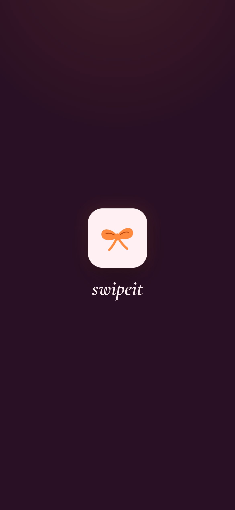
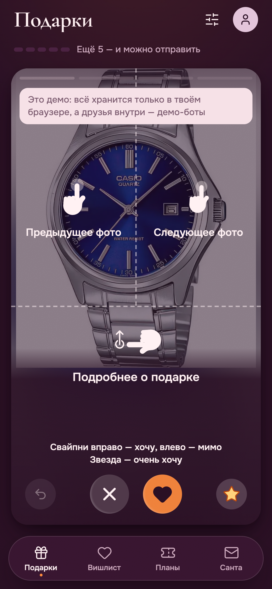
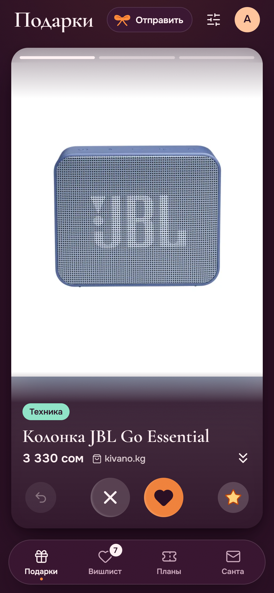
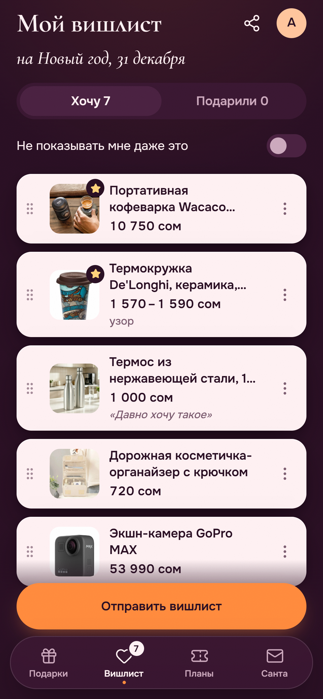
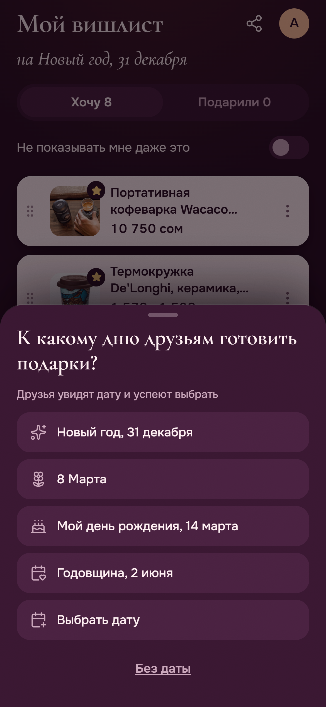
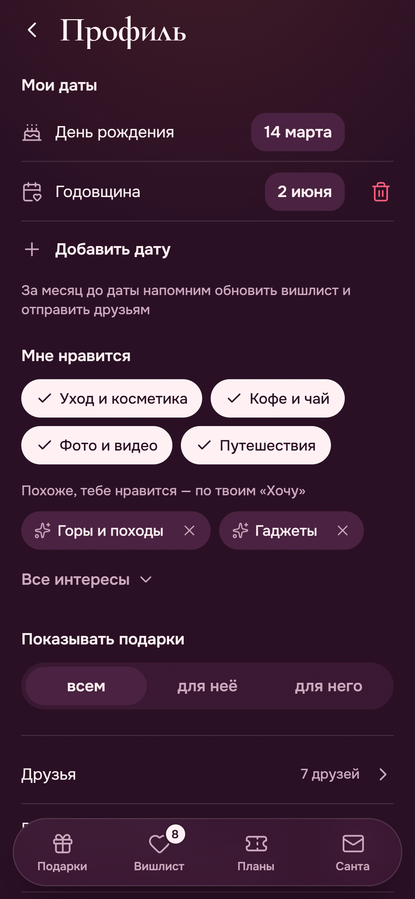
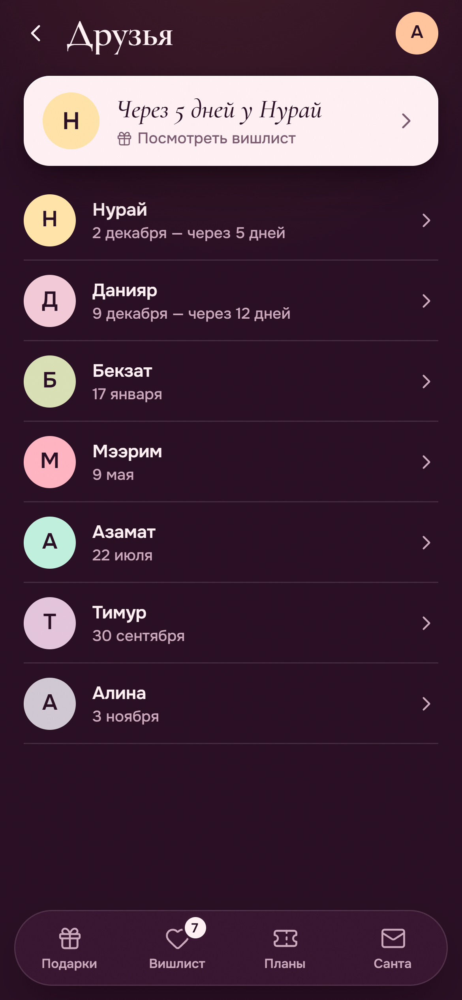
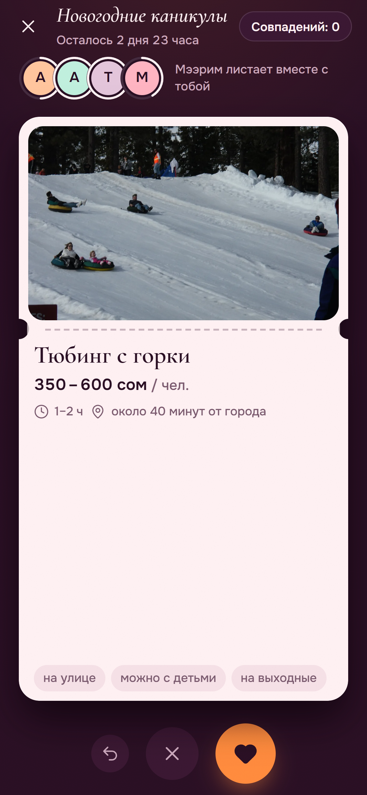
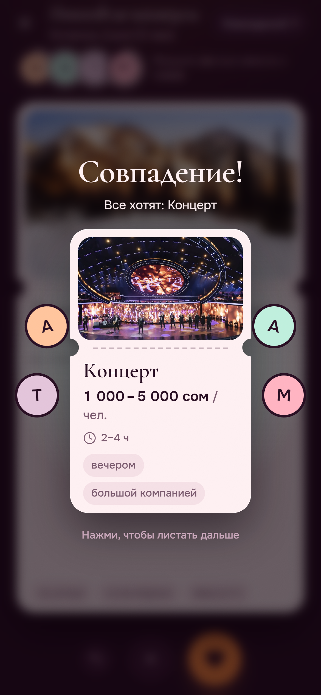
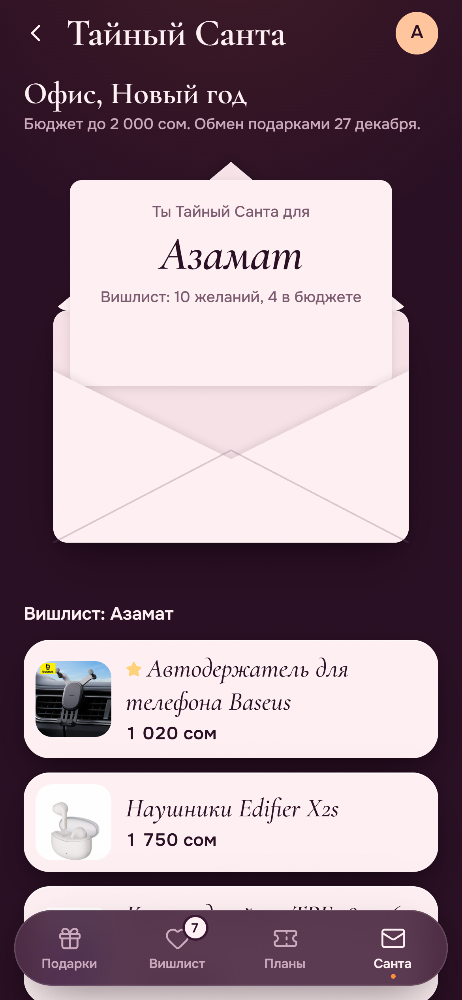

# SwipeIt

**Свайпай подарки, которые хочешь сам.** Друзья увидят — и угадают с подарком.

Мобильное веб-приложение (PWA) для Кыргызстана, цены в сомах:

- **Подарки.** Свайпаешь подарки для себя, как в приложении знакомств. С пяти желаний (из ленты или своих) вишлист можно отправить ссылкой.
- **Вишлист.** Друзья открывают его по ссылке без регистрации и бронируют подарок, чтобы его не повторили. А не знаешь, что подарить, — отправь другу «ссылку-фильтр»: он сам выберет подарки в твоих рамках, даже не видя цен.
- **«Че делать будем?»** Компания свайпает занятия и сразу видит совпадения, а спорное решает честный барабан или голосование.
- **Тайный Санта.** Жеребьёвка с исключениями, конверт с подопечным и его вишлист в бюджете игры. Чужих пар не видит никто.

<table>
  <tr>
    <td></td>
    <td></td>
    <td></td>
    <td></td>
  </tr>
  <tr>
    <td></td>
    <td></td>
    <td></td>
    <td></td>
  </tr>
  <tr>
    <td></td>
    <td></td>
    <td></td>
    <td></td>
  </tr>
</table>

### Демо: https://seitek2002.github.io/swipeit/

Открой на телефоне — после прелоадера сразу лента подарков, без анкеты: первая карточка покажет, как свайпать. Готовый профиль с вишлистом — в профиле, «Войти как демо-пользователь». Всё хранится только в твоём браузере, друзья внутри — демо-боты, которые бронируют подарки, свайпают планы и играют в Санту сами. Приложение можно установить на главный экран и открывать без интернета.

Как показывать демо (7 минут на одном телефоне, тест с друзьями по Wi-Fi, ссылка для всех) — [docs/DEMO.md](docs/DEMO.md).

> Демо. Фото и цены товаров взяты с маркетплейсов, ссылки ведут в магазины. Авторы фото занятий — на странице «Авторы фото» в профиле.

## Запуск у себя

Нужен Node.js 22 или новее.

```bash
cd frontend
npm install
npm run dev        # http://localhost:3000
```

### Тест с друзьями по Wi-Fi

```bash
cd frontend
npm run lan        # сборка + сервер на ноутбуке, адрес и QR — в терминале
```

Ноутбук становится маленьким сервером: телефоны в той же Wi-Fi открывают адрес из терминала, проходят знакомство и работают с общими данными в реальном времени — брони, планы, Санта. Подробно, в том числе что делать, если телефон не открывает адрес, — [frontend/README.md](frontend/README.md#тест-с-друзьями-по-wi-fi).

## Как устроено

- `frontend/` — Next.js 16 (статическая сборка), TypeScript, Tailwind v4, zustand, TanStack Query, архитектура FSD. Данные — изоморфный мок-сервер: тот же код работает в браузере (localStorage) и на ноутбуке в режиме «Локальная сеть». Подробнее — [frontend/README.md](frontend/README.md).
- `catalog/` — каталог подарков и занятий.
- `docs/` — [PRD](docs/PRD.md), [дизайн](docs/DESIGN.md), [техническая спецификация](docs/TECH_SPEC.md), [задачи](docs/TASKS.md), [прогресс](docs/PROGRESS.md), [как показывать демо](docs/DEMO.md).

Сайт обновляется сам после каждого push в `main` (GitHub Actions → GitHub Pages).
